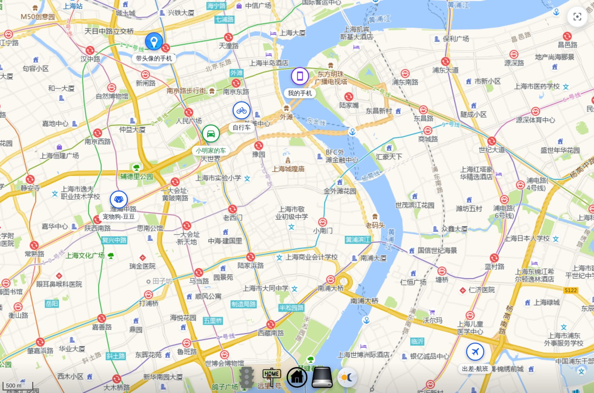
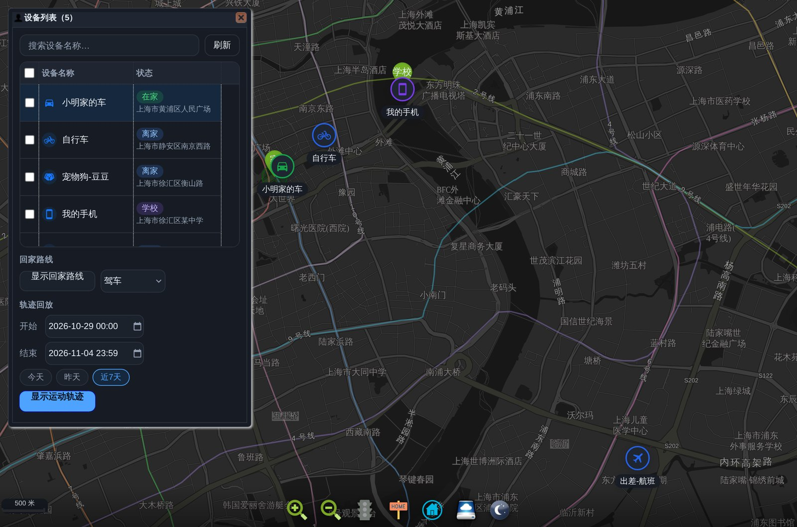
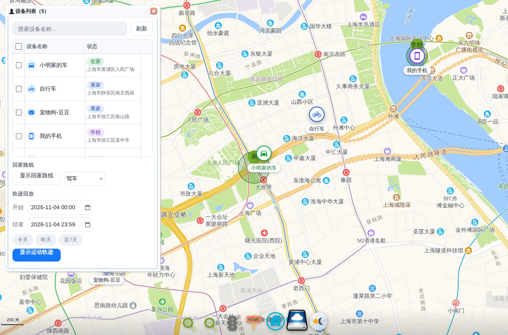

<p align="center">
  
</p>

# 云尚（高德）地图 · Yunshang Gaode Map

> 仓库名 / 集成域：`yunshang_map`；**前端（侧边栏、地图页面、Lovelace 卡片、集成页面）显示名为「定制地图」。**

Home Assistant 自定义集成：在地图上显示设备追踪（`device_tracker` / `geo_location`）位置、运动轨迹回放、回家路线与时间，支持高德 / 百度 / OSM 多种底图与深色 / 浅色 / 跟随系统三种主题。

本项目 Fork 自 [dscao/gaode_maps](https://github.com/dscao/gaode_maps)（墨澜地图），并在此基础上统一了中英文名称、补全中文化界面、增加主题切换并优化了设备对话框的 UI 与交互。



<p align="center">
  
  
</p>

---

## 功能特性

- 侧边栏地图面板：`云尚（高德）地图`
- Lovelace 卡片：`custom:yunshang-map`（支持可视化编辑、多设备）
- 追踪设备优先显示图标（实体图片 / mdi 图标 / 名称推断 / 默认图标）
- 显示设备运动轨迹并回放动画（开始 / 暂停 / 继续 / 停止）
- 显示回家路线（驾车 / 骑行 / 步行），并计算回家用时
- 多底图：高德（矢量/卫星/路况）、百度（矢量/卫星/路况）、OSM
- 实时路况、家的位置与范围（默认关闭）、设备列表开关
- 三种主题：浅色 / 深色 / 跟随系统（底部主题按钮一键切换）
- Lovelace 卡片：多设备、历史轨迹、可视化编辑器、随卡片尺寸自适应

## 本版本相对上游的改动

1. **中英文名称统一**：仓库 `yunshang_map`，集成域 `yunshang_map`，中文名「云尚（高德）地图」，英文名「Yunshang Gaode Map」，侧边栏、卡片、配置流程、HACS、README 全部一致。
2. **三种主题模式**：新增浅色 / 深色 / 跟随系统，页面底部新增主题配置按钮，与原有缩放、路况、家、设备列表按钮并列摆放；主题选择会被记住，并同步到内嵌卡片。
3. **追踪设备优先显示图标**：地图标记优先使用 `entity_picture`，其次使用实体的 `mdi` 图标，其次按设备名称关键字推断（汽车、自行车、公交、地铁、飞机、轮船、宠物等），最后回退默认定位图标；状态用颜色区分（在家 / 离家 / 区域）。
4. **界面尽可能中文化**：EasyUI 中文语言包、设备列表、状态、按钮、提示、时间区间、错误信息等全部中文。
5. **设备对话框优化**：图标 + 状态徽章列表、设备搜索、手动刷新、轨迹快捷时间区间（今天 / 昨天 / 近 7 天）、时间范围校验、加载与空状态提示、双击设备打开实体详情、Esc 关闭面板、窄屏自适应，并适配深色主题。

### v1.1.0 更新

6. **前端显示名改为「定制地图」**：侧边栏入口、地图页面标题、Lovelace 卡片、集成页面统一显示「定制地图」。
7. **设备对话框重构**：改为自绘面板（不再依赖 EasyUI），桌面端为可拖动浮窗、移动端为底部抽屉；分为「设备 / 轨迹回放 / 回家路线」三个页签。
   - 设备：头像图标、状态徽章、地址、距家距离、回家用时；搜索、刷新、**显示/隐藏标记**、**一键追踪（地图跟随）**
   - 轨迹回放：**切换追踪设备时自动切换轨迹**、快捷时间区间、加载提示、动画控制
   - 回家路线：多选设备、出行方式切换、显示/隐藏
   - 「管理追踪设备」可直接跳转集成选项页
8. **缩放与轨迹流畅度优化**：
   - 缩放时不再逐帧刷新工具栏图标（只在 `zoomend` 更新一次）、去掉标记的 CSS 过渡、缓存底部工具栏坐标
   - 轨迹点超过 800 个时自动抽样显示（保留首尾点），并改为**异步加载**，大轨迹不再阻塞页面
   - 移除页面内 EasyUI 依赖（体积与解析开销大幅降低）
9. **修复**：重命名内部 `Map` 类，避免覆盖浏览器原生 `Map` 对象。

### v1.2.0 更新

10. **轨迹动画速度大幅提升**：基础速度改为按轨迹长度自适应（约 5～20 秒完成），并新增 `0.5× / 1× / 2× / 4× / 8×` 速度按钮，动画播放中可实时切换速度（自绘 rAF 动画，含车头转向与已走过轨迹绘制，重绘节流保证流畅）。
11. **适配视野**：地图右上角新增「适配视野」按钮；首次加载自动适配所有设备与家的位置（借鉴 map-card 的 `autoFit` / `reset_focus`）。
12. **GPS 精度圈**：设备带有 `gps_accuracy` 时在地图上显示精度范围圈（借鉴 map-card）。
13. **卡片可视化编辑器**：`custom:yunshang-map` 现在支持可视化编辑（实体多选 + 缩放级别），不再提示「此类元素没有可视化编辑器」；同时支持一个卡片显示多个设备，并自动适配视野。
14. 从 [ryanh7/map-card](https://github.com/ryanh7/map-card) 借鉴了 GPS 精度圈、自动适配视野、实体多选与配置项组织方式。

### v1.3.0 更新

15. **地图渲染引擎迁移到 Leaflet（栅格瓦片）**：平移/缩放改为瓦片图层 CSS 变换，和 HA 官方地图卡片一样顺滑；实测拖动、滚轮缩放期间无 50ms 以上的长任务。
16. **多底图**：高德（矢量/卫星/路况）、百度（矢量/卫星/路况）、OSM 共 7 种底图，可在面板底部的「底图」下拉框切换；卡片通过 `map_type` 配置。百度使用 proj4leaflet 自定义 CRS 纠正投影，OSM 带版权标注。
17. **多设备历史轨迹同屏**（卡片）：`hours_to_show` 内拉取每个设备的历史位置，按设备颜色绘制（分段渐隐），轨迹点可悬停查看时间，每 60 秒自动刷新。
18. **卡片配置对齐官方地图卡片**：`entities`、`geo_location_sources`、`hours_to_show`、`default_zoom`、`theme_mode`，另加 `map_type`、`aspect_ratio`；可视化编辑器包含全部选项。
19. **卡片尺寸自适应**：分区（sections）布局中铺满卡片区域；masonry 布局默认 16:9，可用 `aspect_ratio` 指定比例；拖动改变卡片大小时地图自动跟随（实测 820×520 → 460×300 正确适配）。
20. **轨迹动画改用实体的图标/头像**（不再使用小汽车图片），有 `entity_picture` 时显示头像。
21. **默认不显示「家的位置」和「家的范围」**，需要时点底部工具栏图标开启。
22. **移除底部放大/缩小按钮**：改用滚轮 / 双指缩放，底部工具栏更简洁。
23. **轨迹页设备选择改成徽章列表**：头像 + 名称 + 状态，横向滚动，与设备列表/回家路线页签风格统一；播放前默认选中第一个可用设备。
24. **修复深色模式切换**：主题选项改为直接绑定事件并二次应用，点击「深色/浅色/跟随系统」立即生效（地图瓦片、面板、标记样式同步切换）。
25. **高德 JS 按需加载**：只有「回家路线」需要路线计算时才加载高德 JS API，首屏更快、也不影响底图显示。

### v1.4.0 更新

26. **三个页签统一列表风格**：「设备 / 轨迹回放 / 回家路线」都使用同一套设备行样式（头像 + 名称 + 状态徽章 + 距离/地址），轨迹页用圆形单选指示当前追踪设备、回家路线页用圆形复选，整行点击即可选择（触屏友好）。
27. **移动端与折叠屏适配**：
   - 直板机竖屏：底部抽屉 + 安全区适配（`env(safe-area-inset-bottom)`）、触控行高 ≥56px、输入框/按钮加大、页签加高
   - 横屏手机 / 折叠屏半开：矮屏自动切换全宽底部抽屉，紧凑行高，带拖拽手柄
   - 折叠屏展开（约 600-1000px 宽）：浮窗宽度限制在 400px，保持地图可见
   - 折叠屏外屏等超窄屏（≤340px）：紧凑排版，避免文字截断
   - 手机端取消列表内嵌滚动，统一由面板整体滚动，避免“双重滚动”
28. **卡片自动继承移动端布局**：卡片 iframe 尺寸较小时（如手机上的卡片）自动切换为底部抽屉，设备列表/轨迹/回家路线在小窗口内同样可用。
29. **主题自动模式快速重试**：解决卡片 iframe 比宿主 HA 主题先加载时可能显示浅色的问题（前 4 秒每 400ms 校准，之后每 4 秒检查）。

### v1.5.0 更新

30. **修复轨迹动画不移动**：距离计算坐标字段兼容问题（`lon/lat` 与 `lng/lat`），轨迹动画现在会按时间轴正常推进、暂停/继续/停止均生效。
31. **播放控制精简为 2 个按钮**：「播放 / 暂停」（同一按钮切换）+「停止」，均为 2 个字；播放结束后自动变回「播放」，可直接重播。
32. **轨迹回放支持多设备**：轨迹页签可勾选多个设备，同时绘制并同步播放各自轨迹（不同颜色 + 颜色圆点标识），时间范围与倍速控制共用。
33. **回家路线与运动轨迹互斥**：显示运动轨迹时自动隐藏回家路线；显示回家路线时自动隐藏运动轨迹。
34. **手机抽屉可拖动**：拖动顶部把手调节抽屉高度（45% / 68% / 90% 三档吸附），下滑超过阈值关闭抽屉，轻点把手在收起/展开间切换；横屏手机与折叠屏半开改为**左侧固定侧栏**（保留更多地图）；手机打开面板时自动隐藏底部工具栏；页头/页签/设备行进一步紧凑化。
35. **修复勾选失效**：卡片或手机端点击勾选框时列表被重绘导致勾选不生效的问题（改为原位更新）。

### v1.6.0 更新

36. **轨迹回放改为两个滑块控制**：
    - **回放范围滑块**：从「近 5 分钟 / 15 分钟 / 30 分钟 / 1 小时 / 3 小时 / 6 小时 / 12 小时 / 1 天 / 2 天 / 7 天」中选择历史跨度，替代原来的「开始/结束时间输入 + 今天/昨天/近 7 天」按钮；拖动后若正在显示轨迹会自动重新加载
    - **轨迹位置滑块**：拖动可前后定位到轨迹的任意时刻（地图标记与已走过轨迹同步跳转），播放时自动前进；播放中拖动会自动暂停，松手后点「播放」从当前位置继续
    - 两个滑块都带进度填充色，右侧显示当前时间；移动端加大触控区域
37. **轨迹页更省空间**：设备列表在桌面/手机上保持限高（可滚动），回放范围、速度、播放/停止、轨迹位置等控件一屏内更容易触达
38. **隐藏轨迹时取消未完成的加载请求**，避免加载与隐藏操作同时进行导致的状态错乱

### v1.7.0 更新

39. **修复「轨迹位置」只能向前拖动**：向后拖动时设备位置与已走过轨迹现在会同步倒退（按时间轴二分定位）。
40. **「轨迹位置」右侧显示当前地理位置 + 时间**：优先使用历史记录里的 `address` / `location_name`；没有地址时先判断是否在某个区域（显示「家 / 公司 / 学校」等区域名），再退回经纬度。
41. **手机抽屉下滑关闭不再“弹回”**：关闭过程中保持当前高度直接下滑关闭，不会先恢复到初始高度再关闭。
42. **统一文字与布局**：
    - 「回放范围 / 动画速度 / 轨迹位置」等字段标题统一为 12px
    - 页签文字、设备名、副标题、按钮、提示等字号与行高统一
    - 「追踪设备 / 设备」页签的“可多选”改成更轻的备注样式，避免标题过长
43. **轨迹按时间轴推进**：播放/拖动进度时按真实时间比例定位，时间与地址随滑块变化；设备静止的时间段标记不动、时间继续走（更符合真实轨迹）。

### v1.8.0 更新

44. **轨迹位置的地理显示优先级**：区域名称（家 / 公司 / 学校等）优先，其次是历史记录中的具体地址；**不再显示经纬度**（两者都没有时只显示时间）。
45. **轨迹设备列表独立滚动**：手机/折叠屏上，追踪设备列表可以单独上下滚动（有固定最大高度），下方的回放范围、速度、播放、轨迹位置等控件保持不动，设备较多时也能完整选择。
46. **修复抽屉打开/关闭动画**：之前布局代码把内联 `transform` 写死为 none，覆盖了 CSS 动画，导致面板“瞬间消失”；现在打开/关闭恢复为平滑的上滑/下拉动画（关闭动画结束后再隐藏面板）。

### v1.9.0 更新

47. **轨迹位置支持逆地理编码**：当坐标不在任何区域内、历史记录里也没有地址时，按需调用高德 JS API 把经纬度反查成具体地址（带 260ms 节流与坐标缓存，不会拖慢拖动）；依然**不显示经纬度**。
48. **手机抽屉紧凑模式（三级收起）**：拖动变小时按优先级收起内容，保证「播放/停止 + 轨迹位置」能与地图上的轨迹同屏显示：
    - 抽屉高度 < 560px：设备列表收缩为更矮的可滚动区域
    - < 470px：隐藏设备列表、回放范围、动画速度和「显示/隐藏运动轨迹」按钮，只保留播放/停止与轨迹位置
    - < 350px：再隐藏页签与底栏，最大化地图区域
49. 逆地理编码只在需要时加载高德 JS（与回家路线共用同一按需加载逻辑），并缓存结果。

### v1.10.0 更新

50. **地图页/卡片改为复用 HA 当前登录会话（不再依赖长期访问令牌）**：内嵌在 HA 中时，页面会自动读取父页面的 `hass` 连接，通过 WebSocket 的 `get_states` / `history/history_during_period` 获取设备、区域和轨迹历史（与 ryan 的 map-card 使用 `hass.connection` 取历史的思路一致），**长期访问令牌变为可选**。
51. 只有在**独立浏览器**中直接打开地图页面（没有父级 HA 页面）时，才回退到 REST API + 长期令牌；其他情况下不产生 `/api/states`、`/api/history/period` 请求。
52. 集成选项里的「长期访问令牌」文案更新为“可选”，并说明其只用于独立打开页面的场景；已有令牌配置可以保留，也可以删除。

> 原有功能（轨迹回放、回家路线与用时、路况、家的范围、卡片嵌入等）均保持不变。

### 关于借鉴 ryan 的 map-card

参考仓库（Leaflet 版 Lovelace 地图卡片）中值得借鉴的能力与当前处理：

| 能力 | 说明 | 本集成状态 |
| --- | --- | --- |
| GPS 精度圈 | 按 `gps_accuracy` 画精度范围 | ✅ 已实现 |
| 自动适配视野 / 重置聚焦 | `autoFit` + 聚焦按钮 | ✅ 已实现 |
| 多实体显示 | `entities` 数组、每实体颜色 | ✅ 卡片已支持多设备（按状态着色） |
| 可视化编辑器 | 卡片配置 editor | ✅ 已实现（实体多选 + 缩放） |
| 多底图（高德/百度/卫星/路况/OSM） | 自定义 CRS + 瓦片图层 | ✅ 已实现（7 种底图，百度用 proj4leaflet 纠正投影） |
| 多设备历史轨迹同屏（不同颜色、渐隐） | `ha-map-plus` 的 paths 绘制 | ✅ 已实现（卡片 `hours_to_show`） |
| `hours_to_show` 历史轨迹 | 历史数据 + tooltip 时间 | ✅ 已实现（每 60 秒刷新） |
| 历史数据获取方式 | `hass.connection` WebSocket 取历史，无需令牌 | ✅ 已实现（内嵌时自动复用 HA 会话） |
| 卡片 aspect_ratio / geo_location_sources | 卡片布局与数据源配置 | ✅ 已实现 |

### 卡片可视化编辑器与配置项

在仪表盘「添加卡片 → 按卡片 → 定制地图」即可用可视化编辑器配置（参考 HA 官方地图卡片的选项）：

| 配置项 | 说明 | 默认 |
| --- | --- | --- |
| `entities` | 设备实体（可多选，兼容旧 `entity_id`） | 必填 |
| `geo_location_sources` | `geo_location` 实体的来源（source），多个用逗号分隔；填 `all` 表示全部 | 空 |
| `hours_to_show` | 显示过去几小时的多设备历史轨迹；0 表示不显示 | 24 |
| `default_zoom` | 打开时的缩放级别（3-18） | 14 |
| `map_type` | 底图：amap / amap-satellite / amap-traffic / baidu / baidu-satellite / baidu-traffic / osm | amap |
| `theme_mode` | 主题：auto（跟随 HA）/ light / dark | auto |
| `aspect_ratio` | 卡片宽高比，如 `16:9`、`4:3`；留空则按布局自适应 | 空 |

等价 YAML：

```yaml
type: custom:yunshang-map
entities:
  - device_tracker.tesla_location
  - device_tracker.es6_location
hours_to_show: 24
default_zoom: 14
map_type: amap
theme_mode: auto
aspect_ratio: 16:9
```

- 多设备时自动适配视野；卡片里点底部「设备列表」按钮可打开设备列表 / 轨迹回放 / 回家路线。
- 分区（sections）布局下卡片会铺满所占区域；masonry 布局默认 16:9，可通过 `aspect_ratio` 调整。
- 拖动改变卡片大小时地图会自动调整尺寸。

### 底图与第三方库

| 底图 | 说明 |
| --- | --- |
| 高德地图 / 高德卫星 / 高德路况 | 高德栅格瓦片（GCJ02），无需 JS API 即可显示；只有回家路线计算时按需加载高德 JS API |
| 百度地图 / 百度卫星 / 百度路况 | 百度栅格瓦片（BD09），使用 proj4leaflet 自定义 CRS 纠正投影 |
| OSM 地图 | OpenStreetMap 标准瓦片（WGS84），在地图右下角显示版权标注 |

地图渲染使用 [Leaflet](https://leafletjs.com/)（BSD-2-Clause），聚合使用 [Leaflet.markercluster](https://github.com/Leaflet/Leaflet.markercluster)（MIT），百度投影使用 [proj4js](https://github.com/proj4js/proj4js) 与 [proj4leaflet](https://github.com/kartena/Proj4Leaflet)（MIT）。这些库都已打包在 `www/leaflet/` 下，不依赖外部 CDN。

## 安装

### 方式一：手动安装（推荐）

1. 下载本仓库（`main` 分支 zip 或 `git clone http://192.168.19.3:3021/yunshang/yunshang_map.git`）。
2. 将 `custom_components/yunshang_map` 整个目录复制到 Home Assistant 的 `config/custom_components/` 下。
3. 重启 Home Assistant。
4. 打开「设置 → 设备与服务 → 添加集成」，搜索「云尚（高德）地图」并完成配置。

### 方式二：HACS 自定义存储库

HACS → 集成 → 右上角 → 自定义存储库，填入仓库地址 `http://192.168.19.3:3021/yunshang/yunshang_map`，类型选择「集成」，然后下载安装并重启。

## 配置说明

| 配置项 | 说明 |
| --- | --- |
| 高德地图 Web 端 Key | 必填。在 [高德开放平台](https://console.amap.com/dev/key/app) 申请；仅「回家路线/回家用时」的路线计算需要（按需加载），不影响底图与轨迹回放。 |
| 安全密钥 jscode | 2021-12 之后申请的 Key 需要同时配置，不需要则留空。 |
| Home Assistant 长期访问令牌 | **可选**。内嵌在 HA 中显示时会自动复用当前登录会话（WebSocket），通常无需填写；仅在独立浏览器直接打开地图页面时需要。 |
| 追踪设备 | 可在「选项」中选择需要显示的 `device_tracker`；不选择则显示全部。 |

> 提示：追踪设备只针对 `device_tracker` 类型实体。

## 让没有图标的设备显示用户头像 / 图标（纯 HA 配置）

地图标记的图标优先级为：

```
entity_picture（图片） > 实体自定义 icon（mdi 图标） > 按设备名称推断 > 默认图标
```

因此**不需要改插件代码**，直接在 Home Assistant 中配置即可复用现有机制：

1. **用户头像**：在「设置 → 人员」中为每位成员上传/更换头像（`person.*` 实体的 `entity_picture` 就是该头像）。
2. **给 device_tracker 指定头像**：在 `customize.yaml` 中为对应实体补充 `entity_picture`（图片地址取对应 `person` 实体的 `entity_picture`）：

   ```yaml
   device_tracker.hostname0:
     entity_picture: /api/image/serve/<图片ID>/512x512   # 取对应 person 实体的 entity_picture
   ```

   修改后重载配置（开发者工具 → YAML → 重新加载核心配置）或重启 Home Assistant。
3. **只想要图标（不要头像）**：在「设置 → 设备与服务 → 实体」中选择该 `device_tracker`，点击齿轮修改图标（如 `mdi:cellphone`、`mdi:car`），插件会自动读取实体 `icon`。
4. 注意：`/api/image/serve/...` 中的图片 ID 与人员头像绑定，**更换头像后需要同步更新 `customize.yaml` 里的地址**；也可以把头像图片放到 `config/www/` 下，用 `/local/xxx.png` 引用（更稳定）。

> 本仓库的部署实例中，为 4 部手机追踪器和 2 个 GPS 追踪器配置了对应成员的头像，车辆（Tesla / ES6）继续使用各自的 `entity_picture` 车标。

## 使用说明

- **侧边栏面板**：点击侧边栏「云尚（高德）地图」。底部按钮依次为：放大、缩小、路况、家的位置、家的范围、设备列表、主题模式。
- **主题切换**：点击底部主题按钮，选择「浅色 / 深色 / 跟随系统」，设置会被记住。
- **显示轨迹**：设备列表中选中设备 → 选择时间区间（可用「今天 / 昨天 / 近 7 天」快捷按钮）→ 点击「显示运动轨迹」，随后可用动画按钮回放。
- **回家路线**：在设备列表中勾选设备 → 点击「显示回家路线」，可切换驾车 / 骑行 / 步行。
- **打开实体详情**：点击地图上的设备图标，或双击设备列表中的设备。

## 从「墨澜地图（gaode_maps）」升级

本集成使用了新的集成域 `yunshang_map`，与旧版 `gaode_maps` 不冲突，但需要重新添加一次集成：

1. 删除旧的 `custom_components/gaode_maps` 目录（可选，避免重复）。
2. 安装 `custom_components/yunshang_map` 并重启。
3. 「设置 → 设备与服务 → 添加集成 → 云尚（高德）地图」，重新填入高德 Key、jscode 与长期令牌。

## 致谢

- [dscao/gaode_maps](https://github.com/dscao/gaode_maps)：本项目的直接上游。
- [cxlwill/ha-inkwavemap](https://github.com/cxlwill/ha-inkwavemap)：更早的实现。
- [shaonianzhentan/google_maps](https://github.com/shaonianzhentan/google_maps)：参考实现。
- [高德开放平台](https://lbs.amap.com/)：地图服务。
- [Material Design Icons](https://pictogrammers.com/)：设备图标（Apache License 2.0）。

## 许可

本项目沿用上游的 [GNU General Public License v3.0](LICENSE)。
